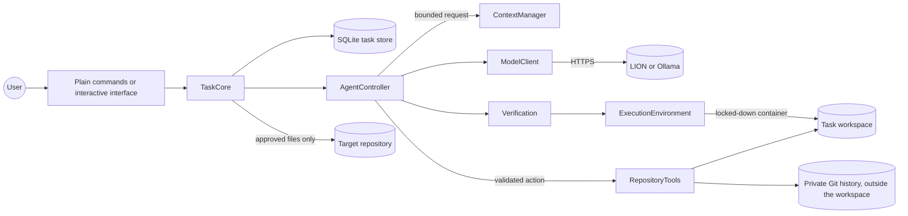
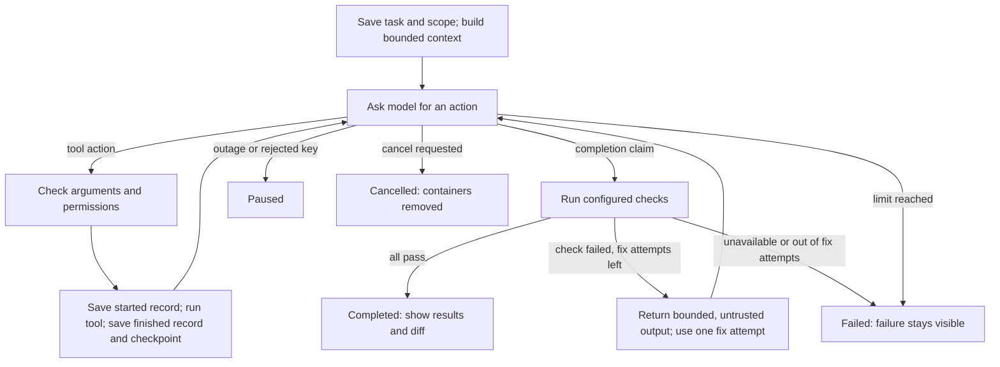
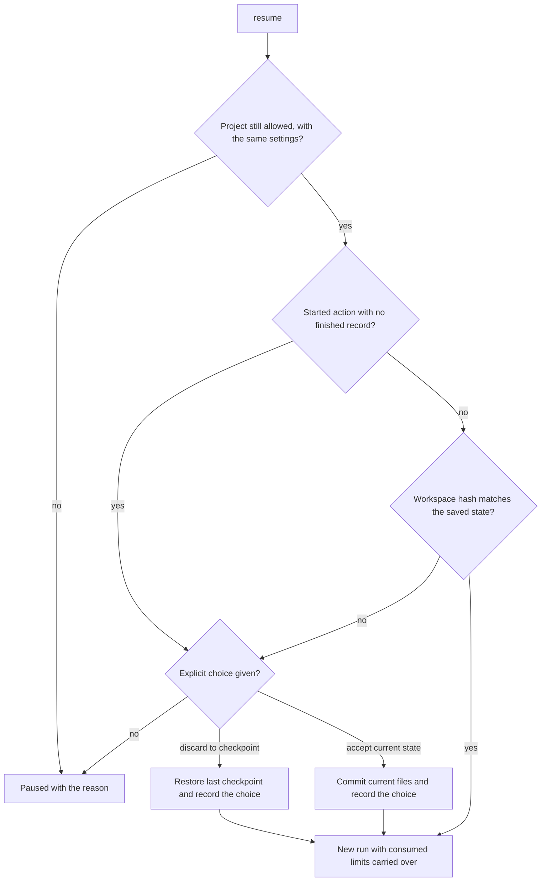

# Coding Harness

A Python coding harness. You choose an allowed project and submit a feature request. The harness gives a language model bounded context and read, navigation, edit, and check tools, uses failed checks to guide fixes, saves every step, and lets you cancel, reopen, resume, and review the work. Repository code only runs in locked-down Docker containers. Nothing reaches the target repository until you approve it.

In this project, the brief's "session" means a durable **task**. See `GLOSSARY.md` for the vocabulary.

## Setup

| Need | Details |
|---|---|
| Python | 3.11 or newer (tested with 3.14). |
| Docker | Docker Desktop running. Without it, checks report `UNAVAILABLE` and no repository code runs. |
| Model | The LION gateway (FH network or VPN required), or a local Ollama model. |
| Target | `git submodule update --init`. The OpenStock core check also needs the git-ignored `target-repository/data/openstock.db`. |

```bash
python3 -m venv .venv
.venv/bin/pip install -r requirements-dev.txt
docker build -t coding-harness-check:1 -f docker/check.Dockerfile target-repository
cp .env.example .env    # then add your key; .env is git-ignored
```

## Model settings

| Variable | Default |
|---|---|
| `OPENAI_BASE_URL` | `https://lion.aida.cs.technikum-wien.at/v1` |
| `OPENAI_API_KEY` | none |
| `CODING_HARNESS_MODEL` | `Qwen/Qwen3.6-35B-A3B` |
| `CODING_HARNESS_MODEL_TIMEOUT` | `300` seconds |

Any OpenAI-compatible endpoint works. For local Ollama use `OPENAI_BASE_URL=http://localhost:11434/v1` and `CODING_HARNESS_MODEL=qwen3:8b`. Non-local endpoints must use HTTPS.

## Allowed projects

`projects.toml` lists what tasks may run against. Each project sets its path, configured checks, allowed changes, excluded paths, fixtures, and generated files. Anything not listed is refused.

## Using it

```bash
./harness                                # the interactive interface
./harness projects                       # list allowed projects
./harness start openstock "Add ..."      # run in the foreground; Ctrl-C cancels
./harness list                           # all tasks and their states
./harness show <id>                      # details, steps, errors, checks, diff
./harness cancel <id>                    # from a second terminal
./harness resume <id> [--discard-to-checkpoint | --accept-current-state]
./harness continue <id> "instruction"    # follow up on an unapproved task
./harness review <id> [--approve [--force] | --reject]
```

Exit codes for `start`, `resume`, and `continue`: 0 completed, 1 failed, 2 paused, 130 cancelled.

In the interactive interface, plain text starts a new task, and `/help` lists `/project`, `/tasks`, `/show`, `/diff`, `/resume`, `/continue`, `/cancel`, `/approve`, `/reject`, and `/quit`. Esc cancels. The status line shows the task, actions and tokens used, and how to cancel.

## Components

| Component | File | Responsibility |
|---|---|---|
| Interfaces | `cli.py`, `interactive.py` | Plain commands and the inline interface. No task logic. |
| `TaskCore` | `core.py` | The one entry point for interfaces: start, list, show, cancel, resume, continue, review, approve, reject. |
| `AgentController` | `agent.py` | Advances one run: validates replies, enforces limits and fix attempts, checks for cancellation. |
| `ModelClient` | `model.py` | OpenAI-compatible client with retries and token usage. |
| `ContextManager` | `context.py` | Builds each bounded model request. |
| `RepositoryTools` | `repository.py` | Read, search, navigation, and edit tools, confined to the workspace and allowed changes. |
| `TaskStore` | `store.py` | Tasks, runs, actions, and an append-only event history in SQLite. |
| `ExecutionEnvironment` | `execution.py` | Runs configured checks in containers, and fails closed. |
| `Verification` | `verification.py` | Check results and the diff against the starting state. |
| Workspaces | `workspace.py`, `projects.py`, `review.py` | Credential-free copies, private history, allowlist, and applying approved files. |



The loop for one run:



Resume:



## Design decisions

**Context.** Each model request is limited to 32,000 estimated tokens (4 characters per token): up to 4,000 for trusted instructions, scope, and acceptance criteria, which are never compressed and always come first; 4,000 for a repository map of files and top-level Python symbols; 12,000 for files selected by matching task terms and following dependencies; and 12,000 for recent history, including a summary of older steps. A request too long for the trusted budget is refused. The summary is written by the harness from saved actions, with no model call, so repository text cannot manipulate it. Repository text and tool output sit in labelled untrusted blocks and never in the system message.

**Limits per task, kept across runs.** 60 tool actions, 80 model responses, 3 consecutive invalid replies or denied actions, 3 fix attempts, and 200,000 tokens. Tokens use the service's usage figures, and a missing figure is an estimate that is labelled as one.

**Stopping rule.** A task ends as completed (every check passes), failed (a limit was reached, or checks are failing or unavailable), cancelled, or paused. A model's completion claim is never enough on its own, and a claim with no changed files is sent back once. "Completed" means the configured checks pass; it does not prove the requested feature works, which is what task-specific acceptance checks are for. An outage or rejected key pauses the task and uses no fix attempts.

**Checkpoints.** For each tool action, the harness saves a `started` record, runs the action, then saves a `finished` record with the result and a workspace hash, and commits changes to the task's private Git history.

**Safe resume.** Resume rechecks the project's settings and the workspace hash, including the harness's own edits, and carries consumed limits over. A `started` record with no `finished` record is an uncertain action, and it is never replayed. Any mismatch or uncertain action pauses the task until you choose to discard to the last checkpoint or accept the current state. Model requests can be re-sent, because they don't change the workspace, and their tokens still count.

**Private history outside the workspace.** Repository code can write anywhere in the workspace, so a `.git` directory there could plant hooks or configuration that the harness would then run on the host. The Git directory therefore lives outside it, out of reach of containers.

**Containment.** See `docs/adr/0001-docker-replaces-sandbox-exec.md`. Each check runs in a new container with no network, a non-root user, all capabilities dropped, a read-only root filesystem, and memory, CPU, and process limits. Only the task workspace is mounted. A probe confirms the boundary before each check. A Git worktree or disposable copy alone is not treated as a sandbox.

**Cancellation.** `cancel` sets a flag in the store and signals the running process. The controller checks the flag before every model request, tool action, and check. Model requests run on a worker thread, so a late reply is discarded, and a stuck check's container is removed.

**Credentials.** Task workspaces are built from the starting commit, leaving out configured and always-excluded paths, and adding only declared fixtures and generated files. The API key stays in the harness process, and never reaches logs, saved state, the workspace, or containers.

**Approval.** Only files within the allowed changes are applied. Approval is blocked when the target's commit, or a changed file, differs from the task's starting state, unless you pass `--force`. Checks then run on a fresh copy. Push, merge, and deployment are not available.

## Tests

```bash
.venv/bin/python -m pytest -q tests -rs
```

Core tests use scripted models and a fake container runner, so they need no account, key, or Docker. Tests that need real Docker are reported as skipped when the daemon or image is missing; run them with Docker up before relying on the result.

## Feature: quote expiry

`acceptance/quote_expiry/accept.py` is the protected check, kept outside the agent's writable area and mounted read-only. The runner clones the target to a disposable copy, proves the feature check fails on the starting code for the expected reason, runs the harness from one unsplit request, then runs the acceptance and core checks on a copy of the result and writes a record:

```bash
.venv/bin/python acceptance/run_quote_expiry.py --prove-only   # no model needed
.venv/bin/python acceptance/run_quote_expiry.py
```

## Known limits

- Symbol and dependency tools understand Python only; text search covers everything else.
- Token counts for context are estimates, at 4 characters per token.
- LION needs the FH network or VPN, is best-effort, and can be limited or revoked. Ollama is the fallback, and small local models may need several attempts.
- Files a check creates outside the allowed changes are left out of the diff and of approval, but they do exist in the workspace.
- Restored or newly created workspace files are not world-writable, which is fine on Docker Desktop but could stop a container's non-root user writing them on Linux.
- Cancelling signals a saved process ID, which could in principle have been reused after a crash.
- This is a single-user tool, not a multi-user security boundary.

## Credits

Built for the FH Technikum Wien AAIA semester project, using Claude Code (Anthropic) for implementation help. Dependencies: `python-dotenv`, `prompt_toolkit`, `rich`, and `pytest` and `mypy` for development. The target repository is OpenStock.
